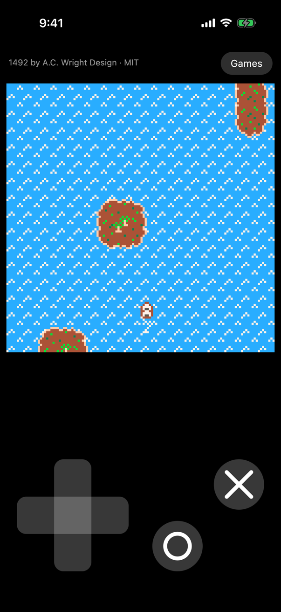
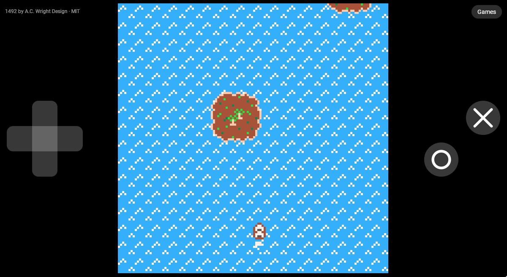

# Kiko: Pico-8 Player in Kotlin Multiplatform

[](https://github.com/vitorpamplona/kiko-kmp/releases/latest)
[](https://central.sonatype.com/artifact/com.vitorpamplona.kiko/kiko)
[](https://jitpack.io/#vitorpamplona/kiko-kmp)
[](https://github.com/vitorpamplona/kiko-kmp/actions/workflows/build.yml)
[](LICENSE)

A runtime for 128x128, 16-color fantasy-console cartridges (`.p8`, `.p8.png`, `.p8.rom`) in
Kotlin Multiplatform: its own Lua interpreter with 16:16 fixed-point numbers, the console's memory
map, graphics, text, sound, input, pause menu and cart formats. It depends on nothing but the
Kotlin stdlib and runs on the JVM, Android, iOS, macOS, Linux, JavaScript and Wasm.

<p align="center">
  
  &nbsp;
  
</p>
<p align="center"><sub><i>1492</i> by A.C. Wright Design (MIT), in the demo app on iOS and in a browser.</sub></p>

It comes in three artifacts, so an app takes only what it needs:

| Artifact | Depends on | What it does |
|---|---|---|
| `kiko` | the Kotlin stdlib | Runs one cart: your app calls `step()` once per frame, draws the pixels and plays the samples. |
| `kiko-player` | `kiko`, kotlinx.coroutines | Plays it in real time without UI: the game thread, the frame clock, a hang watchdog, saves and the device's sound. |
| `kiko-compose` | `kiko-player`, Compose Multiplatform | One composable, `KikoGame`, with the screen, touch controls, keyboard and gamepad, pausing with the app. |

[Amethyst](https://github.com/vitorpamplona/amethyst) uses them to play carts posted on Nostr
inside the app.

Written from scratch from the public manual and community documentation of the formats. It is not
affiliated with the makers of any console, and contains none of their code or assets.

## Install

```kotlin
dependencies {
    implementation("com.vitorpamplona.kiko:kiko-compose:<version>") // or kiko-player, or kiko
}
```

| Requirement | |
|---|---|
| JVM | Java 17 |
| Android | minSdk 26 |
| Apple | iosArm64, iosSimulatorArm64, macosArm64 (`kiko-compose`: iOS only) |
| Linux | linuxX64 (not `kiko-compose`) |
| Web | js and wasmJs, in browsers and Node.js (`kiko-compose`: browsers) |

## Usage

The whole integration in Compose is one call
([`OneCall.kt`](demo/shared/src/commonMain/kotlin/com/vitorpamplona/kiko/demo/examples/OneCall.kt)):

```kotlin
import androidx.compose.foundation.layout.fillMaxSize
import androidx.compose.runtime.Composable
import androidx.compose.ui.Modifier
import com.vitorpamplona.kiko.compose.KikoGame

@Composable
fun OneCall(url: String, download: suspend (String) -> ByteArray?) {
    // Loads the cart, plays it with touch controls, keyboard, gamepad and sound, and pauses while
    // the app is in the background. kiko never downloads anything: `download` is your app's own.
    KikoGame(key = url, source = { download(url) }, modifier = Modifier.fillMaxSize())
}
```

The next questions each have a short example, compiled and tested with the demo:

| Example | Shows |
|---|---|
| [`KeepTheGame.kt`](demo/shared/src/commonMain/kotlin/com/vitorpamplona/kiko/demo/examples/KeepTheGame.kt) | A `KikoPlayer` in a ViewModel, so a rotation keeps the game; saves (`KikoSaveStore`); your own words on screen (`KikoLabels`) |
| [`OwnLayout.kt`](demo/shared/src/commonMain/kotlin/com/vitorpamplona/kiko/demo/examples/OwnLayout.kt) | The pieces `KikoGame` is made of (`KikoScreen`, `KikoStatus`, `KikoDirectionPad`, `KikoActionButtons`, `kikoKeys`) in a layout of your own |
| [`Headless.kt`](demo/shared/src/commonMain/kotlin/com/vitorpamplona/kiko/demo/examples/Headless.kt) | `kiko-player` without Compose: play a cart, press buttons, copy frames |
| [`RuntimeAlone.kt`](demo/shared/src/commonMain/kotlin/com/vitorpamplona/kiko/demo/examples/RuntimeAlone.kt) | `kiko` alone, for an app with its own loop: load a cart (`CartLoader`), give it a `ConsoleHost`, then step, render and play its sound each frame |

### The runtime alone

`kiko` runs one cart and nothing more: your app owns the thread (with
`FantasyConsole.RECOMMENDED_STACK_BYTES` of stack), calls `step()` once per frame, draws the
128x128 pixels from `render()` and plays the samples in `audioBuffer`
([`RuntimeAlone.kt`](demo/shared/src/commonMain/kotlin/com/vitorpamplona/kiko/demo/examples/RuntimeAlone.kt)).

Everything a cart can reach outside itself goes through `ConsoleHost`, and each method has a
default: logging, saves (`cartdata`), the other carts of a game in several parts (`load`,
`reload`), the local time zone (`stat(90..95)`) and memory pressure.

Carts come from strangers, so loading and running treat them as hostile: a malformed or malicious
cart fails to load or stops with an error, without crashing the host, filling its memory or keeping
a core busy after `abort()`.

## Compatibility

Tested against 164 carts from the public forum: 151 run and render correctly through 300 frames of
random input, and 11 are the first part of a game in several carts and stop where the next cart
would load (the host decides how to find it). Known gaps: the sound filters (noise, buzz, detune,
reverb, dampen) are not applied, the kana glyphs draw blank, and there is no CPU budget, so a heavy
cart runs as fast as the host allows instead of slowing down. Design notes: [`plans/`](plans).

## Try it

```bash
./gradlew :demo:run                          # desktop: a small game written for the demo
./gradlew :demo:run --args="/path/to/game.p8.png"
./gradlew :demo:wasmJsBrowserDevelopmentRun  # browser
./gradlew :demo-android:installDebug         # Android, on a connected phone or emulator
open demo/ios/KikoDemo.xcodeproj             # iOS: pick a simulator or your phone, then Run
```

Every version offers a short list of games: the demo's own cart, *Snowman* by aquova (CC0) and
*1492* by A.C. Wright Design (MIT), with each game's author and license on screen. Thanks to
them for sharing their games; [`demo/CREDITS.md`](demo/CREDITS.md) has the sources and
licenses. All versions but the browser page can also open a cart of yours. The `pages.yml` workflow publishes that page to
GitHub Pages from `main`. None of this is published to Maven.

The iOS build runs Gradle from Xcode (`:demo:embedAndSignAppleFrameworkForXcode`), so Xcode
needs a JDK 17+ it can find (`JAVA_HOME`, or `org.gradle.java.home` in
`~/.gradle/gradle.properties`) and an Android SDK (`ANDROID_HOME` or `local.properties`), since
every module also builds for Android. On a phone, pick your team under Signing & Capabilities.
Games play silently on iOS for now: the player has no iOS sound output yet.

## Building

```bash
./gradlew :kiko:jvmTest :kiko-player:jvmTest :kiko-compose:jvmTest
./gradlew checkLinux checkWebNode   # every check that runs on Linux, as the pre-push hook does
# Play a folder of carts headless and keep a screenshot of each (carts are not in this repo):
./gradlew :kiko:jvmTest --tests '*CartSmokeTest*' -Dkiko.carts=/path/to/carts -Dkiko.out=/tmp/screens
```

See [`AGENTS.md`](AGENTS.md) for the layout, the rules and the release process.

## License

MIT. Carts are not part of this project: each keeps its author's license.
